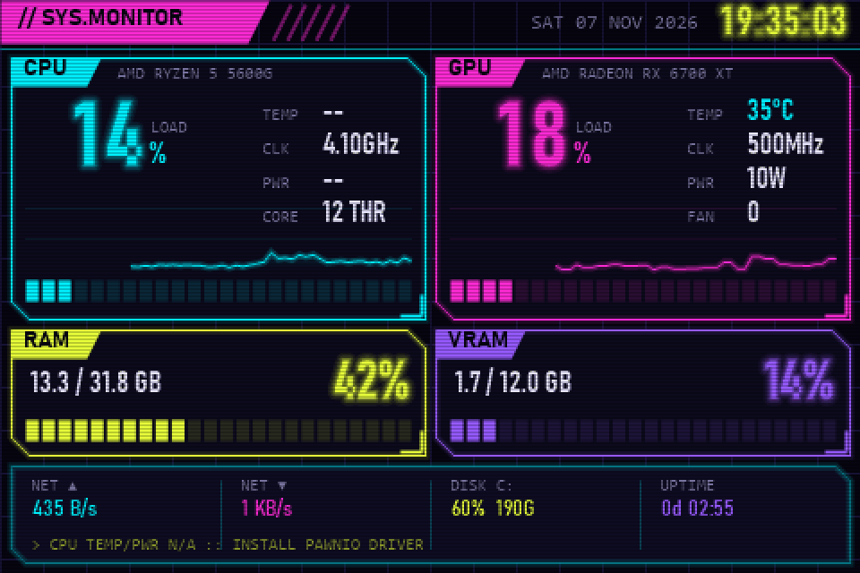
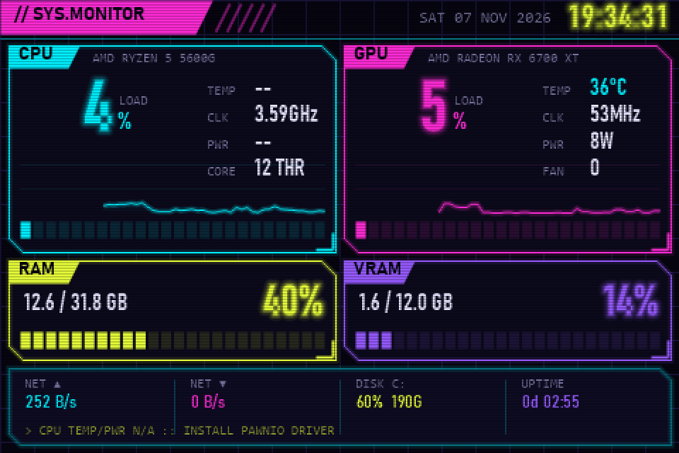

# CyberMonitor

A lightweight, cyberpunk-retro system monitor for **3.5" USB "smart screen" displays**
(Turzx / Turing-compatible, USB `VID_1A86 & PID_5722`, 480×320).

It replaces the vendor app with a single tray application that auto-detects your
hardware and streams a neon dashboard to the screen.



## Features

- **Auto-detection** of CPU, GPU (prefers the discrete card when an iGPU is also present), RAM, VRAM, network and system disk
- **CPU:** load, temperature, clock, package power, thread count
- **GPU:** load, temperature, core clock, power, fan, VRAM usage
- **RAM / VRAM** usage bars, network up/down, disk usage, uptime, clock and date
- Cyberpunk-retro look: neon glow, chamfered panels, segmented bars, live history graphs and CRT scanlines
- Fixed-width clock and numbers, so nothing jitters while values change
- Sends only the parts of the screen that changed, which keeps the USB serial link fast
- Automatically finds the display's COM port
- **Turns the screen off when Windows shuts down, restarts or goes to sleep**, and back on after resume
- Tray menu: preview window, brightness, rotate 180°, exit



## Requirements

- Windows 10/11 x64
- [.NET 8 Desktop Runtime](https://dotnet.microsoft.com/download/dotnet/8.0)
- Administrator rights (the app asks on start; needed for hardware sensors)
- **Optional but recommended:** the [PawnIO](https://pawnio.eu/) driver. Without it, Windows does not expose
  CPU temperature and power to any user-mode app, and the dashboard shows `--` for those values
  (CPU clock falls back to Windows' performance counters). Install it with:

  ```
  winget install namazso.PawnIO
  ```

## Usage

1. Close the vendor software (it keeps the COM port busy).
2. Download `CyberMonitor.exe` from [Releases](../../releases) and run it.
3. Double-click the tray icon to open the live preview.

Settings are stored in `settings.json` next to the executable:

```json
{
  "Port": "auto",
  "Brightness": 80,
  "Flip": false,
  "RefreshMs": 1000
}
```

To start with Windows, create a scheduled task that runs `CyberMonitor.exe` at log on with highest privileges.

## Building

```
dotnet publish -c Release -r win-x64 --self-contained false -p:PublishSingleFile=true
```

`CyberMonitor.exe --snapshot out.png [frames]` renders the dashboard to PNG without a display
(useful for previews; build with `-p:NoAdmin=true` to skip the UAC prompt while developing).

## Display protocol

Notes gathered for interoperability:

- USB CDC serial, 115200 baud 8N1, DTR and RTS enabled
- Every command starts with 6 bytes: `x`, `y`, `ex`, `ey` packed as 10-bit values, then the command byte
- Commands: `101` reset, `108` screen off, `109` screen on, `110` brightness (0 = max, 255 = off),
  `121` orientation (16-byte packet), `197` draw bitmap
- Bitmaps are RGB565 little-endian, row by row, for the rectangle `(x, y)–(ex, ey)`

See [`TuringLcd.cs`](TuringLcd.cs).

## Disclaimer

This is an independent project and is not affiliated with or endorsed by the display manufacturer.
Product names are used only to describe compatibility.

## License

MIT — see [LICENSE](LICENSE). Third-party components are listed in [THIRD-PARTY-NOTICES.md](THIRD-PARTY-NOTICES.md).
